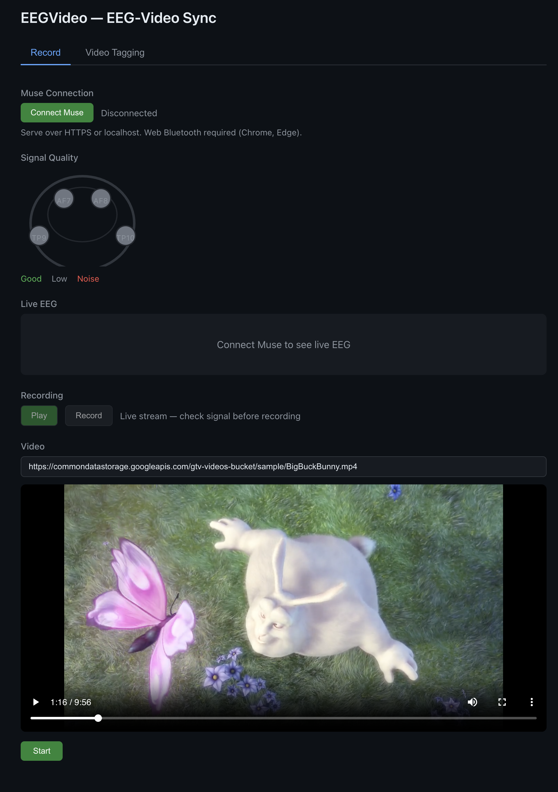
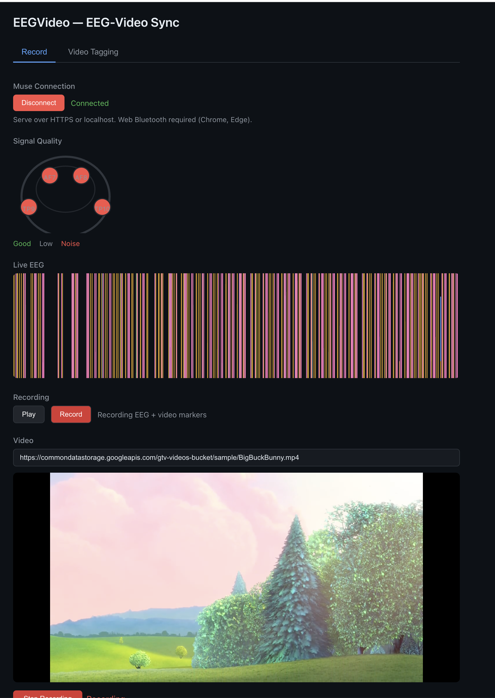

# EEGVideo — EEG-Video Sync

Record EEG from a [Muse](https://choosemuse.com/) headband (Muse S Athena, Muse S, Muse 2, or Muse 2016) while watching a video or recording from your camera, with synchronized timing markers for frame-accurate alignment.

### 🌐 Live Web App (No Install Required)
👉 **[https://kylemath.github.io/EEGVideo/](https://kylemath.github.io/EEGVideo/)** *(Open in Google Chrome, Edge, or Opera for Web Bluetooth)*

---

## Local Development — get running in 3 minutes

> **You need:** [Node.js](https://nodejs.org/) **v18 or newer** and **Google Chrome** (or Edge).
> If you use [nvm](https://github.com/nvm-sh/nvm), the repo includes an `.nvmrc` so `nvm use` will pick the right version.

### Step 1 — Clone the repo

```bash
git clone https://github.com/kylemath/EEGVideo.git
cd EEGVideo
```

### Step 2 — Install dependencies

The app code lives inside the `EEGVideo/` subfolder. Install from there:

```bash
cd EEGVideo
npm install
```

### Step 3 — Start the dev server

```bash
npm run dev
```

You should see output like:

```
  VITE v5.x.x  ready in XXX ms

  ➜  Local:   http://localhost:5173/
```

### Step 4 — Open the app

Open **http://localhost:5173** in **Chrome** (or Edge). Safari and Firefox will **not** work because they lack Web Bluetooth support.

That's it — the app is running. See the full usage guide below.

---


*App before connecting the Muse headband*


*App with Muse connected, showing live EEG and active recording*

## Features

- **Muse connection** via Web Bluetooth — works directly in the browser with **Muse S Athena (Gen 3 / MS-03)**, Muse S, Muse 2, and Muse 2016 (no Muse mobile app or forwarding required)
- **Signal quality** head map showing electrode contact (TP9, AF7, AF8, TP10)
- **Live EEG** 4-channel chart (2 s window, 256 Hz)
- **Synchronized recording** — EEG samples and video timing markers (button press, first frame, periodic frame markers) saved to a single CSV
- **Video Tagging tab** — replay recorded video at 0.5x/1x/2x, step through frames, add manual markers, scene detection, import/export markers

## Prerequisites

- **Node.js 18+** — download from <https://nodejs.org/> or use `nvm install 18`
- **Google Chrome or Microsoft Edge** — Web Bluetooth is required; Safari/Firefox are not supported
- The app must be served over **HTTPS or localhost** (the dev server handles this automatically)
- A **Muse headband** (Muse S Athena, Muse S, Muse 2, or Muse 2016)

## Detailed usage

### 1. Start the dev server

From the `EEGVideo/` subdirectory (where `package.json` lives):

```bash
npm run dev
```

Open **http://localhost:5173** in Chrome.

### 2. Connect your Muse

1. Turn on your Muse headband (make sure it is **not** connected to the Muse mobile app on your phone so it advertises over Bluetooth).
2. Click **Connect Muse** in the app.
3. Select your device from the browser's Bluetooth pairing dialog.
4. The app automatically detects whether your device uses the **Muse S Athena** multiplexed protocol (`273e0013`) or the **Classic** Muse protocol (`273e0003–0006`), initializes streaming, and updates the Signal Quality head map.

### 3. Check signal quality

The head diagram shows electrode quality with color coding:

| Color | Meaning |
|-------|---------|
| **Green** | Good signal (1.5–10 µV std dev) |
| **Gray** | Low / no signal |
| **Red** | Noisy signal |

Adjust the headband until all four electrodes are green before recording.

### 4. Set up the video

Paste a video URL into the **Video** input field (any URL that the browser can play as an HTML5 video). A sample video is pre-filled for testing.

### 5. Record

1. Click **Record** to switch from live-stream mode to recording mode.
2. Click **Start** below the video to begin playback and recording simultaneously.
3. EEG samples, video frame timestamps, and event markers are buffered and flushed to a combined CSV every 2 seconds.
4. Click **Stop Recording** to finish. The CSV is downloaded automatically.

### 6. Tag the video (optional)

Switch to the **Video Tagging** tab to:

- Replay the video at different speeds (0.5x, 1x, 2x)
- Step forward/backward frame-by-frame
- Add semantic markers at specific timestamps
- Run automatic scene detection
- Export/import marker sets

## Output format

The recording produces a single CSV with interleaved rows:

- **EEG rows** — `timestamp, TP9, AF7, AF8, TP10`
- **Marker rows** — `timestamp, marker_type, value` (types: `video_start`, `frame`, `button_press`, `semantic`)

## Production build

```bash
npm run build
npm run preview
```

## Tech stack

| Technology | Role |
|------------|------|
| React 18 | UI components |
| Vite 5 | Dev server and bundler |
| muse-js | Muse headband connection and EEG decoding |
| RxJS 7 | Reactive EEG data streams and pipes |

## Contributing

Contributions are welcome! Please feel free to submit a Pull Request.
